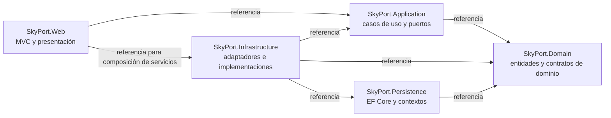
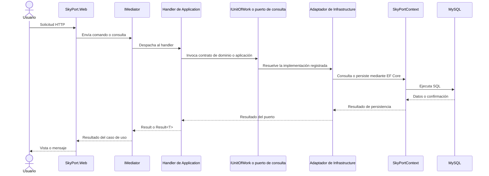

# Arquitectura de SkyPort Manager

SkyPort Manager se organiza en cinco proyectos con dependencias dirigidas hacia el dominio. La solución está preparada para una arquitectura hexagonal: la aplicación define los casos de uso y sus puertos, mientras que Infrastructure conecta esos puertos con Persistence y otros adaptadores. El diagrama muestra las referencias entre proyectos; el flujo de solicitud describe el diseño previsto según las convenciones del repositorio.

## Proyectos y referencias

En el diagrama, una flecha `A → B` significa que el proyecto A tiene una referencia a B.



### Responsabilidad de cada proyecto

- **SkyPort.Domain** es la capa interior y no depende de otros proyectos. Su responsabilidad incluye las entidades persistidas y, cuando se incorporen casos de uso, los contratos propios del dominio. Hoy contiene las entidades generadas en `Entities/`; los puertos de dominio y las excepciones aún no tienen implementaciones.
- **SkyPort.Application** contiene los casos de uso, sus comandos, consultas y DTOs, además de puertos que la aplicación necesita. Depende de Domain y no accede directamente a EF Core ni a `SkyPortContext`.
- **SkyPort.Persistence** contiene los contextos EF Core y la configuración de persistencia. `SkyPortContext` representa las 14 tablas operativas de SkyPort; `SkyPortIdentityDbContext` representa las tablas estándar de ASP.NET Core Identity. Depende de Domain.
- **SkyPort.Infrastructure** implementa puertos de Application y Domain. Aquí corresponden los repositorios, la unidad de trabajo, las consultas, los exportadores y los servicios externos. Actualmente incluye `Pbkdf2PasswordHasher`, que implementa `IPasswordHasher`.
- **SkyPort.Web** contiene los controladores MVC, los ViewModels y las vistas. Recibe solicitudes web y presenta resultados; no debe contener reglas de negocio ni consultar `DbContext` directamente.

El proyecto `tests/SkyPort.Tests` referencia los cinco proyectos para probar sus componentes. Se omite del diagrama de dependencias de producción.

## Flujo de una solicitud

El flujo previsto para un caso de uso sigue esta dirección:



Este flujo es la arquitectura acordada, no una afirmación de que todos sus componentes ya estén conectados. En el estado actual, `HomeController` solo devuelve sus vistas y `Program.cs` registra MVC; todavía no registra MediatR, los contextos de EF Core ni una unidad de trabajo. Application contiene por ahora el puerto `IPasswordHasher`, y Infrastructure su implementación `Pbkdf2PasswordHasher`. Los casos de uso y adaptadores restantes se incorporarán por módulo.

## Persistencia y generación de entidades

El proyecto sigue el enfoque **base de datos primero**. Los scripts SQL son la fuente del esquema; EF Core no administra ese esquema con migraciones Code First. `database/01_schema.sql` crea las tablas operativas, `database/02_identity.sql` instala las tablas de Identity y `database/03_seed.sql` agrega datos ficticios de prueba.

Después de ejecutar los tres scripts en la base local `skyport_db` y configurar `ConnectionStrings:DefaultConnection` en user-secrets, se puede correr desde la raíz del repositorio:

```powershell
.\tools\scaffold.ps1
```

El script restaura `dotnet-ef` y genera `SkyPortContext` en `src/SkyPort.Persistence/Context` junto con las entidades de las 14 tablas operativas en `src/SkyPort.Domain/Entities`. Usa `--force`, por lo que sobrescribe esos archivos generados. No genera las tablas Identity: estas se representan mediante `SkyPortIdentityDbContext` y el script `database/02_identity.sql`.

Vuelve a ejecutar el scaffold cuando cambie la estructura de las tablas operativas en `database/01_schema.sql`, después de recrear o actualizar la base local. Los cambios al contenido de `database/03_seed.sql` no requieren regenerar entidades. No edites manualmente las entidades generadas ni `SkyPortContext`; conserva las modificaciones del modelo en los scripts SQL y vuelve a generar desde la base.

La cadena de conexión y los secretos locales no se guardan en el repositorio. Consulta [CONFIGURACION.md](CONFIGURACION.md) para preparar el entorno.

## Estado y tecnologías observadas

Los proyectos apuntan a .NET 10. Persistence usa EF Core Design 9, `Pomelo.EntityFrameworkCore.MySql` y `MySqlConnector`; por tanto, el proveedor efectivo del proyecto es MySQL. La primera sección de `CONVENCIONES.md` aún menciona SQL Server, aunque sus instrucciones de base de datos y el código actual usan MySQL. Este documento sigue el proveedor que aparece en los proyectos y scripts.
